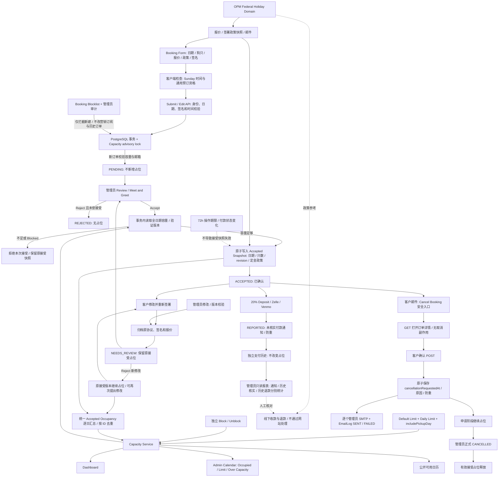

# Silicon Paws Retreat 预订系统重构交付说明

## 行为变化与数据流

旧流程以活动 Hold、人工核实押金、可变的当前订单日期计算占位；待审核订单也可能占位，Hold 到期可释放容量，编辑可立即改变日历。

新流程以数据库中的最近一次管理员接受快照为准：`acceptedDropoffAt`、`acceptedPickupAt`、`acceptedDogs`、`acceptedRevision`、`acceptedDepositPolicySnapshot`。客户提出的修改进入 PENDING / NEEDS_REVIEW，原快照持续占位；重新 Accept 通过容量检查后原子替换快照，正式 CANCELLED 才释放。拒绝未曾接受的订单不占位；拒绝已确认订单的新修改仍保留之前的接受版本，并明确显示“修改被拒绝，原入住仍确认”；客户可继续提出新修改。客户详情与取消邮件显示原接受版本的日期、狗名、数量及押金，避免把未接受的提案误当成已确认内容。

`occupancyByDay()` 是计数唯一规则，`acceptedOccupancyWhere()` 是统一的数据库查询条件。Dashboard、后台日历、公开可用日期和容量检查复用该服务。数量按 SubmissionPet 计数，缺失关联的历史订单为 1；相同 ID 不重复累计。日历统计与明细通过同一 Repeatable Read 数据库快照读取，避免并发操作期间数字与行明细不一致。按 California 本地日期（项目原有 UTC wall-clock 编码）逐日统计，尊重 includePickupDay，包括同日寄养。

Occupied = 当日有效接受快照的狗只数总和。Remaining = max(0, Limit - Occupied)。Blocked 是独立接受限制：封锁不清零 Occupied；降低限额保留订单并标记 Over Capacity。后台明细显示接受日期和狗只数，并按实际计入的月份过滤。

接受、编辑、限额、封锁和黑名单写入共用事务级 PostgreSQL advisory lock；接受在锁内读取容量并更新快照。管理员和客户编辑提交携带版本检查，重复接受被拒绝。

## Payment、取消和黑名单

- 删除 Verify Deposit 入口及服务端 VERIFIED 更新能力。历史 VERIFIED / REPORTED / REFUNDED 数据保留。Report Payment 是未核实的付款通知，不能证明到账，也不改变容量或续期。已记录金额用于避免重复索款，历史核实金额单独保留。
- 收款、到账确认与退款全部在线下处理。Admin → Payments 仅为只读基本报表，分别汇总付款通知数量/金额、历史已核实金额和历史退款金额，保留原金额、状态、备注与参考号。网站没有 Verify Deposit 或退款操作，不新增 Payment 字段或退款数据表，也不推断实际到账余额。签署的 holiday policy 继续显示应保留的 20% 押金，供线下处理参考。预约报表中的报价统一标注 Booking Value，而非实际到账 Revenue。
- 客户邮件中的 Cancel Booking 是已有安全邮件登录链接，打开自己的订单详情和确认表单。GET 不取消订单；具有客户身份的 Server Action POST 才保存申请。原子 updateMany 防重，先提交申请，再尝试所有 ADMIN_EMAIL 收件人；EmailLog 记录每人的成功或失败，邮件失败不回滚申请。客户申请保留接受占位。
- Booking Blocklist 与营销系统分离，独立 PostgreSQL 表和操作事件记录管理员、时间、内部原因。Customers 支持手动邮箱和行内 Block / Unblock，订单详情也支持操作。邮箱 trim/lowercase、唯一主键。前端提交前进行通用资格检查，创建服务在事务内再次强制检查，覆盖访客与登录用户；客户端没有内部原因。营销订阅及历史订单不变。

## 有效期与星期日规则

默认 `holdHours` 从 24 改为 72；已有设置中等于旧默认 24 的值迁移至 72，其他自定义值保留。可可靠识别为创建/编辑后 24 小时的旧 operational deadline 延长 48 小时，其他历史期限保留。

这个 deadline 现在是操作窗口元数据，不是接受版占位的失效条件。14 天订单编辑链接、14 天安全客户邮件入口和 7 天管理员决策链接均未缩短。已接受订单不会在 72 小时后消失。

周日 California 本地 15:00 ≤ 时间 < 18:00 的 drop-off / pickup 在选项中移除；日期变化后清除失效的已选时间。客户端、validateSubmission、新建/修改服务与 API、管理员日期修改再次验证；没有封锁整天星期日。

## Federal Holiday Deposit Policy

依据 [OPM Federal Holiday Schedule](https://www.opm.gov/policy-data-oversight/pay-leave/federal-holidays/)，独立计算 11 个全国适用的联邦节假日的实际日期和通常工作周适用的 observed 日期；包括跨年 observed New Year。仅适用 Washington DC 地区的 Inauguration Day 不适用于 California。

政策：**Holiday Booking Policy: If any date of your stay falls on a U.S. federal holiday, the 20% deposit is non-refundable, regardless of when the booking is cancelled.**

整笔订单押金为总价的 20%，不是整笔费用不可退。报价、签署条款、付款说明、收据和接受邮件显示政策；报价、订单详情和邮件列出金额与命中节假日。现有 holidays.ts 的加价范围和价格算法未改动。

新签名使用 `2026-10-federal-v1` 并保存政策快照；重新签署和管理员编辑均先通过统一 Revision Service 归档旧 agreementVersion、政策、报价与签名。管理员调整日期/价格时仅按该客户已签署的政策版本更新金额，不向旧协议追溯追加新政策。旧订单不被静默套用新条款，重发 PDF 使用原版本条款。接受版本另存政策快照，避免待审核编辑改变已确认订单退款规则。

## 数据库迁移

`prisma/migrations/20261027000000_accepted_booking_domain/migration.sql`：

1. Submission 增加接受日期、只数、revision、接受政策和当前签署政策快照。
2. 回填现有 ACCEPTED 的当前日期与 SubmissionPet 数量；对于有此前接受标记的待审修改，从最后一个 ACCEPTED SubmissionRevision 恢复日期和只数。
3. PlatformSettings 的 holdHours 默认 72，迁移旧默认值及可识别的 24 小时操作期限。
4. 新增 BookingBlocklist 和 BookingBlocklistEvent，增加事件邮箱/时间索引。
5. SubmissionRevision 增加 agreementVersion 和 depositPolicySnapshot，以保留再次签署前的历史条款。

Payment 保持原有列、记录和金额；本迁移不修改 Payment 表。

没有删除业务表、清空数据或运行生产迁移。最终全部 15 个迁移已在全新的本机隔离 PostgreSQL 数据库成功执行；迁移回填还通过了历史接受版本恢复测试。

## 实际验证结果

- `npm run typecheck`：PASS。
- `npm run lint`：PASS，无 warning。
- `npm run build`：PASS，39 个页面/路由构建完成。
- 本地浏览器实测：先在周六选 15:00 / 17:30，切到周日后非法已选时间自动清空，周日选项移除 15:00–17:30；18:00 可选；周一 15:00 可选。没有提交真实订单。
- 14 个自动化测试脚本全部 PASS：pricing、platform、marketing、marketing-contacts、booking-entry、customer-email-links、payment-report、admin-workflow、prescreen-prefill、customer-crud、account-profile-actions、submission-response、profile-autosave、booking-domain。
- 使用本机 127.0.0.1:55439/spr_payment_reports_20261027 全新专用 PostgreSQL；测试脚本拒绝非指定本机端口的数据库。SMTP 使用替身，没有实际发邮件、收款或退款。
- booking-domain 覆盖连续三天、两只狗、历史一只狗、相同订单去重、未接受状态不占位、编辑保留与重新接受、并发及重复 Accept、取消、Hold 过期、限额降低、Block/Unblock、取消通知防重与失败日志、黑名单规范化/权限/审计/营销隔离、联邦节假日定金政策快照和历史协议恢复。
- 新建/编辑 API 的周日拒绝、访客/登录用户的黑名单拒绝、管理员旧协议归档/陈旧版本拒绝、已拒绝修改重新编辑、原接受日期的营销排除及旧 24h deadline 延长/自定义值保留集成测试全部通过。
- 支付报表测试验证分类汇总、分币精度、管理员权限、没有收退款操作控件、历史备注/参考号保留，以及新数据库 Payment 仍为原有 11 个字段。
- 周六/周日/周一 14:30、15:00、17:30、18:00 边界通过；2026 Thanksgiving、Christmas、2027 New Year、observed 和跨年测试通过；加价日期不自动成为定金不可退日期。
- 完整输出见 `docs/booking-test-results.txt`。`test:decision-urls` 是生成真实操作链接的辅助脚本，不是自动化断言套件，未纳入回归计数。

## 上线前人工检查

1. 桌面本地界面已核对周日切换与失效时间清除；上线前仍需在预发布环境核对实际移动端、报价政策、金额与签名滚动体验。
2. 核对生产历史订单中此前已接受但缺少 ACCEPTED revision / previouslyAcceptedAt 的异常记录；不可从缺失的历史数据可靠推断接受日期，需要人工核实后补录。
3. 用预发布 SMTP 配置核对所有管理员收件人、客户 Cancel Booking 安全入口、邮件失败日志和现有历史协议 PDF。
4. 核对实际 Zelle/Venmo 收款及退款；历史协议的退款仍依据原条款，不追溯应用新政策。
5. 正常发布前备份数据库并在预发布数据副本执行迁移。此次未部署、未迁移生产数据库、未合并 main。

## Booking 生命周期与 Calendar Capacity 架构

## 修改文件清单

- `README.md`
- `app/account/actions.ts`
- `app/account/bookings/[id]/page.tsx`
- `app/account/page.tsx`
- `app/admin/actions.ts`
- `app/admin/booking-blocklist-actions.ts`
- `app/admin/calendar/page.tsx`
- `app/admin/customers/page.tsx`
- `app/admin/page.tsx`
- `app/admin/payments/page.tsx`
- `app/admin/platform-actions.ts`
- `app/admin/reports/page.tsx`
- `app/admin/settings/page.tsx`
- `app/admin/submissions/[id]/page.tsx`
- `app/admin/submissions/_edit-order-form.tsx`
- `app/api/booking-eligibility/route.ts`
- `app/api/submission/edit/route.ts`
- `app/page.tsx`
- `components/AvailabilityCalendar.tsx`
- `components/BookingForm.tsx`
- `components/PriceEstimate.tsx`
- `docs/booking-capacity-refactor.md`
- `docs/booking-test-results.txt`
- `lib/booking-time.ts`
- `lib/decision-emails.ts`
- `lib/decision-handler.ts`
- `lib/email.ts`
- `lib/federal-holidays.ts`
- `lib/form-config.ts`
- `lib/i18n.ts`
- `lib/marketing/worker.ts`
- `lib/pdf-receipt.ts`
- `lib/platform/accepted-booking.ts`
- `lib/platform/booking-blocklist.ts`
- `lib/platform/capacity.ts`
- `lib/platform/customers.ts`
- `lib/platform/payment-email.ts`
- `lib/platform/rules.ts`
- `lib/services/cancellation.ts`
- `lib/services/submission-revision.ts`
- `lib/services/submission-service.ts`
- `lib/validate.ts`
- `package.json`
- `prisma/migrations/20261027000000_accepted_booking_domain/migration.sql`
- `prisma/schema.prisma`
- `scripts/test-admin-workflow.mjs`
- `scripts/test-booking-domain.mjs`
- `scripts/test-customer-crud.mjs`
- `scripts/test-customer-email-links.mjs`
- `scripts/test-payment-report.mjs`
- `scripts/test-platform.mjs`
- `scripts/test-prescreen-prefill.mjs`
